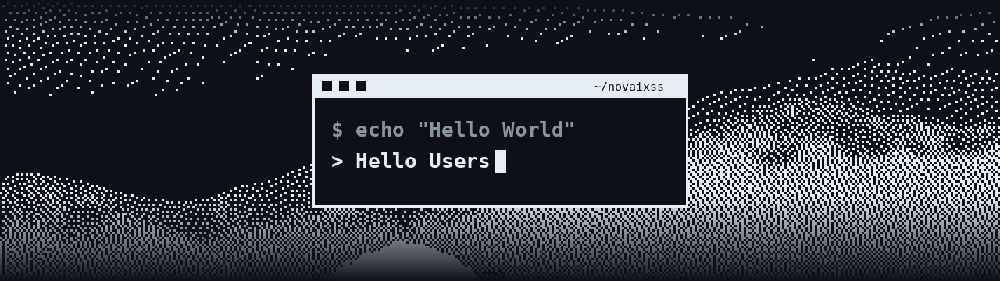

  

<h1 align="center">Hi 👋, I'm Victor Hugo</h1>

<h3 align="center">Information Systems Student · Product-minded Developer</h3>

  <code>Hello World → Hello Users</code>

  Turning ideas into products people actually use — where code meets business.

---

<h2 align="center">🚀 About Me</h2>

<table>
  <tr>
    <td width="58%" valign="top">

**Victor**, here — a 3rd-year **Information Systems** student from Barretos, Brazil.

I'm interested in the space between **development and business**: understanding the real problem first, then building the solution end to end.

🧠 Right now I'm focused on **getting better at solving problems** — breaking them down, finding the root cause and turning it into working software.

💡 Ideas entrepreneur: I'm always validating new business ideas, with the goal of building my own **SaaS products**.

✈️ When I'm not coding, I'm probably planning the next trip.

</td>
<td width="42%" align="center" valign="middle">

</td>
  </tr>
</table>

---

<h2 align="center">🤝 Connect</h2>

  &nbsp;
  &nbsp;
  

---

<h2 align="center">💻 Tech Stack</h2>

  

---

<h2 align="center">📊 GitHub Stats</h2>

  

---

<h2 align="center">📈 Contribution Chart</h2>

  

